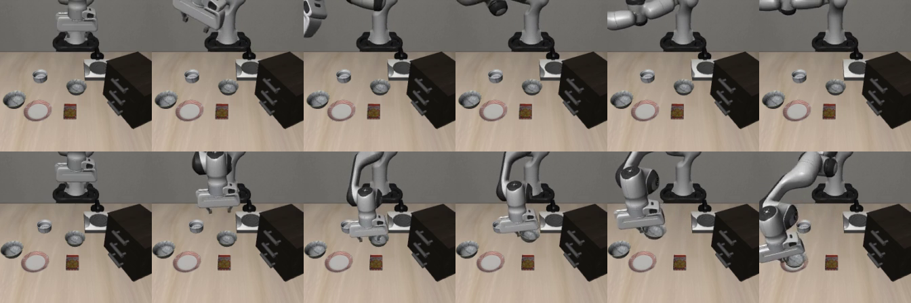
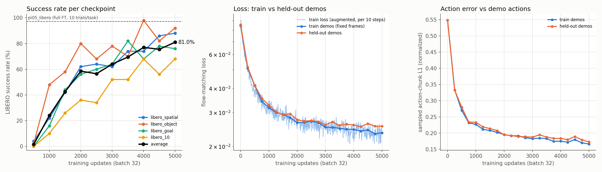

# self-improving-policies

Can a VLM grade the robot? We use vision-language models as reward models for self-improving robot policies:
π0.5 improves itself in LIBERO with reinforcement learning, and the reward for each rollout comes from a VLM
instead of the simulator's success check. Full project proposal: [docs/DML_Project_Proposal.pdf](docs/DML_Project_Proposal.pdf)
(it proposes rejection-sampling fine-tuning; we switched to RL with PPO).

This branch covers:

- getting the π0.5 checkpoints from [openpi](https://github.com/Physical-Intelligence/openpi) running in the LIBERO
  simulator and measuring baselines;
- our LoRA fine-tuned baseline on the LIBERO demonstrations;
- the [grader-in-the-loop RL setup](#grader-in-the-loop-rl): PPO with the simulator's success check vs Robometer-4B
  as the reward (runs in progress).

## Baseline results

Evaluated on one RTX 5090 with openpi's LIBERO eval protocol (seed 7, replan every 5 steps, LIBERO's fixed initial
states).

| Model | Training | Trials/task | Spatial | Object | Goal | LIBERO-10 | Average |
|---|---|---|---|---|---|---|---|
| π0.5-LIBERO (`pi05_libero`) | full fine-tune, 30k × 256 | 10 | 100.0 | 100.0 | 97.0 | 92.0 | **97.2** |
| π0.5-LIBERO, published by openpi | full fine-tune, 30k × 256 | 50 | 98.8 | 98.2 | 98.0 | 92.4 | 96.85 |
| **π0.5 LoRA SFT (ours, `sft_5k`)** | LoRA, 5k × 32, 5.2 GPU-h | 10 | 91.0 | 92.0 | 77.0 | 65.0 | **81.2** |
| π0.5-base (`pi05_base`), zero-shot | none | 2 | 0.0 | 0.0 | 0.0 | 0.0 | **0.0** |

The LoRA SFT baseline is described [below](#lora-sft-baseline).

Each suite has 10 tasks, so 10 trials/task = 100 episodes per suite (roughly ±3 points). Per-task breakdowns, raw
logs and rollout videos (`videos_<suite>/`) are in [results/libero_eval/](results/libero_eval/). The openpi client
keeps one video per task and outcome (`rollout_<task>_{success,failure}.mp4`), so each is the last episode with that
outcome, not every episode.

- **π0.5-LIBERO reproduces the published numbers.** Its weakest tasks are "put both moka pots on the stove" (6/10)
  and "open the top drawer and put the bowl inside" (8/10).
- **π0.5-base gets 0% zero-shot.** The arm moves but drifts away from the objects. It was never trained on LIBERO's
  action space, so this is expected.



*Same task. Top: π0.5-base zero-shot fails. Bottom: π0.5-LIBERO succeeds. Frames are rotated 180°, which is how
the model sees them.*

**What this means for the project:** rejection-sampling fine-tuning needs a starting policy that succeeds some of
the time. π0.5-LIBERO (~97%) has almost no headroom, and π0.5-base (0%) produces no successes to keep. We need an
intermediate starting point, e.g. `pi05_base` fine-tuned on a subset of the LIBERO demos or for fewer steps, or
π0.5-LIBERO evaluated on harder or held-out tasks (LIBERO-90, perturbed scenes). The LoRA SFT run below provides
such checkpoints.

## LoRA SFT baseline

Supervised fine-tuning of `pi05_base` with LoRA on the LIBERO demonstrations: the compute-matched supervised
baseline for the VLM-graded methods. Everything was trained and evaluated on one RTX 5090.

**Recipe.** We deliberately match [imwaterhuang/pi05-libero-lora](https://github.com/imwaterhuang/pi05-libero-lora),
which reports 88% on LIBERO-Spatial with this budget, so their number acts as a sanity check. The config is
`pi05_libero_lora` in [scripts/sip_common.py](scripts/sip_common.py).

- **Model:** openpi's `pi05_libero` model with LoRA variants: rank 16 on the Gemma 2B backbone, rank 32 on the action
  expert. openpi's LoRA freeze filter also trains the SigLIP vision encoder and the action/time projections fully, so
  467M of 3.4B parameters are trainable.
- **Optimization:** batch 32 for 5,000 steps (160k samples, 0.62 epochs). AdamW, openpi's default learning-rate
  schedule (1k warmup to 2.5e-5, cosine over 30k steps, so still 2.4e-5 at step 5k), no EMA.
- **Data:** `physical-intelligence/libero`, the demos of all four suites. 2 demos per task are held out for
  validation, which leaves 1,613 demos (260k frames) for training.
- **Normalization:** the official LIBERO norm stats shipped with `pi05_libero`. A mismatch here is the most common
  cause of failed LoRA reproductions.
- **Compute:** 5.2 GPU-hours of training (3.48 s/step, 22.9 GiB peak GPU memory). Evaluating one checkpoint at
  5 trials/task (200 episodes) took 11–18 minutes.

**Learning curve.** Every 500 steps was evaluated on all four suites at 5 trials/task (200 episodes per
checkpoint). The final checkpoint was also evaluated at 10 trials/task (table above).



| Checkpoint (updates) | GPU-h | Spatial | Object | Goal | LIBERO-10 | Average |
|---|---|---|---|---|---|---|
| 500 | 0.5 | 4 | 2 | 0 | 0 | 1.5 |
| 1000 | 1.0 | 22 | 48 | 16 | 10 | 24.0 |
| 1500 | 1.6 | 42 | 58 | 44 | 26 | 42.5 |
| 2000 | 2.1 | 62 | 80 | 56 | 36 | 58.5 |
| 2500 | 2.6 | 64 | 68 | 60 | 34 | 56.5 |
| 3000 | 3.1 | 62 | 78 | 64 | 52 | 64.0 |
| 3500 | 3.6 | 74 | 70 | 82 | 52 | 69.5 |
| 4000 | 4.2 | 74 | 98 | 68 | 68 | 77.0 |
| 4500 | 4.7 | 86 | 82 | 78 | 56 | 75.5 |
| 5000 | 5.2 | 88 | 92 | 76 | 68 | 81.0 |

With 50 episodes per suite, each cell is roughly ±7 points and the average roughly ±3.5.

- **The sanity check passes.** LIBERO-Spatial reaches 88% at 5 trials/task (the reference repo's protocol) and 91% at
  10 trials/task, against their 88%.
- **It is not converged.** Success still rises at 5k steps, and the run saw each demo frame less than once
  (0.62 epochs). Longer training should close more of the gap to π0.5-LIBERO's 97%.
- **No sign of overfitting.** Held-out demos track the training demos closely: flow loss 0.0255 vs 0.0235, sampled
  action-chunk L1 0.173 vs 0.166, and both are still falling. LIBERO's eval uses the same 40 tasks as training
  (with different initial states), so this measures task mastery rather than generalization to new tasks.
- **Weakest tasks** (10 trials): "put the wine bottle on the rack" 2/10, "open the top drawer and put the bowl
  inside" 3/10, "put both moka pots on the stove" 3/10, "pick up the black bowl in the top drawer of the wooden
  cabinet…" 5/10.
- **For the next stages:**
  - Checkpoints 1500–2500 (42–58% average) are natural starting points for rejection-sampling fine-tuning.
  - The 2,400 rollouts logged during evaluation are a ready-made test set for auditing VLM graders against the
    simulator's success flag: 1,425 successes and 975 failures, each with both camera videos, actions, states and
    the oracle label. They live under `outputs/eval/` (about 0.9 GB, not in git).

**Logged metrics**, in `results/sft_5k/metrics.jsonl`, for comparing against the VLM-graded methods:

- **Training**, every 10 steps:
  - flow-matching loss, gradient norm, parameter norm, learning rate
  - samples seen, epochs, step time, data-loading wait, throughput
  - wall-clock time, GPU-hours, peak GPU memory
- **Validation**, every 250 steps, on 512 fixed frames from the held-out demos and 512 from the training demos (to
  measure the generalization gap):
  - flow-matching loss
  - error of actions sampled as at inference (10 flow steps) against the demo actions: chunk MSE / L1, first-action
    L1, gripper open/close agreement
- **Rollouts**, per episode, in `episodes.jsonl` (see [scripts/libero_rollouts.py](scripts/libero_rollouts.py)):
  - task, initial state, oracle success, steps to success
  - inference calls and latency
  - paths to the videos and the actions/states file

[results/sft_5k/](results/sft_5k/) also has `run_info.json` (config, code versions, hardware, parameter counts),
`data_split.json` (the held-out episodes), the learning-curve CSV and the final 10-trial summary.

## Grader-in-the-loop RL

**Status:** the three runs below started on 2026-10-31 on one RTX 5090; results will be added here.

PPO for flow-matching policies ([πRL](https://arxiv.org/abs/2510.25889), Flow-SDE) through
[RLinf](https://github.com/RLinf/RLinf), plus our extension in [sip_rl/](sip_rl/). One policy is trained on all 10
LIBERO-10 tasks. The config is [configs/rl/libero10_pi05_lora.yaml](configs/rl/libero10_pi05_lora.yaml).

- **Start:** RLinf's few-shot SFT checkpoint
  [RLinf/RLinf-Pi05-LIBERO-SFT](https://huggingface.co/RLinf/RLinf-Pi05-LIBERO-SFT), π0.5 fine-tuned on 1 demo per
  task. It scores 44% on LIBERO-10 with 10-action chunks; RLinf's default 5-action chunks give 29%.
- **Trainable:** LoRA rank 32 on the action expert's attention and MLP layers, plus the value head and the
  action/time/state projections: 18.8M of 3.37B parameters. The VLM is frozen.
  See [sip_rl/expert_lora.py](sip_rl/expert_lora.py).
- **One iteration:**
  1. The policy plays 32 episodes (16 parallel envs × 2) of 480 steps each. Episodes always run to the end. They
     start from 100 new layouts per task, not LIBERO's evaluation layouts
     ([scripts/rl/make_init_states.py](scripts/rl/make_init_states.py)).
  2. The policy is moved off the GPU and the grader labels every episode.
  3. The grader's output is the reward at the last step of the episode.
  4. 4 PPO epochs: batch 256, learning rate 1e-5, GAE γ 0.99 and λ 0.95, clip 0.2.
- **Rewards.** LIBERO's own success check is logged next to the grader's output for every episode, including when it
  is not the reward.

  | Run | Reward |
  |---|---|
  | `oracle` | LIBERO's success check (0 or 1) |
  | `robometer_soft` | [Robometer-4B](https://huggingface.co/robometer/Robometer-4B)'s success probability on the final frames (0 to 1) |
  | `robometer_bin` | 1 if that probability is above 0.5, else 0 |

- **Budget:** a run stops when it has both 12 GPU-hours and 4,096 episodes, or at 24 GPU-hours. Snapshots are saved
  every 512 episodes and at 12 GPU-hours, so the runs can be compared at equal episodes and at equal compute.
- **Evaluation:** on LIBERO's official 50 layouts per task. Snapshots at the cutoffs get 500 episodes; snapshots every
  1,024 episodes get 200 for the learning curve.
- **Logged per episode:** videos (agent view and wrist, 2 fps), the final simulator state, LIBERO's label, and the
  grader's label and score.
- **Logged per iteration:**
  - grader-vs-LIBERO agreement: precision, recall, false-positive rate, AUROC, calibration;
  - the reward split by true outcome;
  - PPO statistics, timing and GPU memory.
- **After training:** we evaluate which sub-goals each episode actually completed, by restoring its final state, to
  see what partial progress the grader rewards. We also make figures and a gallery of false positives and negatives.

## Reproducing

### Requirements

- Linux with an NVIDIA GPU. Tested on an RTX 5090 (32 GB), driver 580, CUDA 13.0. Inference needs well under
  16 GB (JAX preallocates 75% of GPU memory by default). LoRA training peaks at 22.9 GiB.
- [`uv`](https://docs.astral.sh/uv/) and `git`.
- Disk: 25 GB checkpoints and 12 GB Python environments for evaluation. Training adds the 35 GB LIBERO dataset and
  about 9 GB per saved checkpoint (90 GB for the 5k-step run).

### 1. Clone

```bash
git clone -b stratos https://github.com/EthanMBoos/self-improving-policies.git
cd self-improving-policies
```

### 2. Download the checkpoints (~25 GB)

```bash
uv run scripts/download_checkpoints.py
```

This downloads `pi05_base` and `pi05_libero` from openpi's public bucket `gs://openpi-assets/checkpoints/` into
`checkpoints/`, which is gitignored, and verifies every file's checksum. No Google Cloud account is needed. Re-running
skips files that are already valid. Use `--out <dir>` to store them elsewhere, e.g. on scratch storage on PACE.

The checkpoints are JAX/orbax format. openpi has a script to convert them to PyTorch if we need that later.

### 3. Set up openpi and LIBERO

```bash
scripts/setup_openpi.sh
```

This clones openpi (pinned commit) into `third_party/openpi` and creates two environments:

| Environment | Python | Role |
|---|---|---|
| `third_party/openpi/.venv` | 3.11, JAX | **Policy server**: loads π0.5 on the GPU and serves actions over a local websocket (port 8000) |
| `third_party/openpi/examples/libero/.venv` | 3.8 | **Eval client**: runs the LIBERO simulator, queries the server, records success/failure |

They are separate processes because LIBERO/robosuite are pinned to Python 3.8 while openpi needs 3.11. The script
also writes a project-local LIBERO config to `third_party/libero_config/`. The eval script points LIBERO at it with
`LIBERO_CONFIG_PATH`, so any existing `~/.libero` from another project is left alone.

### 4. Evaluate π0.5-LIBERO

Terminal 1 (policy server):

```bash
cd third_party/openpi
uv run scripts/serve_policy.py --env LIBERO policy:checkpoint \
  --policy.config pi05_libero --policy.dir ../../checkpoints/pi05_libero
```

Wait for `server listening on 0.0.0.0:8000`. Then in terminal 2, from the repo root:

```bash
scripts/run_libero_eval.sh outputs/libero_eval/pi05_libero_10trials 10
```

This runs all four suites in parallel against the server and prints the summary table, which is also written to
`<out_dir>/summary.txt`. Arguments are `<out_dir> [trials_per_task=10] [suites...]`. For example,
`scripts/run_libero_eval.sh outputs/test 1 libero_spatial` is a quick 10-episode smoke test.

Runtime on the RTX 5090: about 30 minutes at 10 trials/task. LIBERO-10 is the bottleneck, at around 19 s per
episode. The full protocol of 50 trials/task takes about 2.5–3 hours.

### 5. Evaluate π0.5-base zero-shot

Stop the first server, then in terminal 1 from the repo root:

```bash
third_party/openpi/.venv/bin/python scripts/serve_policy.py --config pi05_base_zeroshot --dir checkpoints/pi05_base
```

Terminal 2:

```bash
scripts/run_libero_eval.sh outputs/libero_eval/pi05_base_zeroshot_2trials 2
```

`pi05_base` ships no LIBERO normalization stats, so this server combines the base weights with the `pi05_libero`
data pipeline and the LIBERO norm stats bundled with the `pi05_libero` checkpoint. It keeps π0.5's default
`discrete_state_input=True` (robot state as text tokens), which is how the base model was pretrained. The
`pi05_libero` fine-tune turns that off.

### 6. Train and evaluate the LoRA SFT baseline

```bash
scripts/run_sft_pipeline.sh sft_5k 5000 5 10   # <exp_name> <steps> <trials/task per checkpoint> <final trials/task>
```

This runs everything in one go, about 8 hours on the RTX 5090:

1. **Train** with [scripts/train.py](scripts/train.py): 5.2 h. On the first run it downloads the LIBERO dataset
   (35 GB) from Hugging Face.
2. **Evaluate every checkpoint** with [scripts/eval_checkpoints.sh](scripts/eval_checkpoints.sh): 2.4 h. It serves
   each checkpoint in turn and rolls out all four suites in parallel.
3. **Evaluate the final checkpoint at 10 trials/task:** 23 min.
4. **Write the learning curve** to `results/<exp_name>/`.

Each stage resumes or skips finished work, so after an interruption you can simply re-run the same command.

Where things go:

- **Checkpoints:** `checkpoints/pi05_libero_lora/<exp_name>/<step>/`, along with `metrics.jsonl`,
  `run_info.json` and `data_split.json`.
- **Rollouts:** `outputs/eval/<exp_name>/<step>/<suite>/` (`episodes.jsonl` plus one folder per episode).

To serve any checkpoint, e.g. for the eval scripts:

```bash
third_party/openpi/.venv/bin/python scripts/serve_policy.py --config pi05_libero_lora \
  --dir checkpoints/pi05_libero_lora/sft_5k/4999
```

openpi names a checkpoint after the 0-based index of its last update, so `4999` is the model after 5,000 updates.

### 7. Grader-in-the-loop RL

This needs about 30 GB of GPU memory and 100 GB of RAM at peak. The RLinf and Robometer environments add about
25 GB on disk.

**Setup:**

```bash
# 1. RLinf (pinned commit) with openpi and LIBERO.
#    Its LIBERO config goes to third_party/rlinf_libero_config, not ~/.libero.
git clone https://github.com/RLinf/RLinf.git third_party/RLinf && git -C third_party/RLinf checkout 30e02369
(cd third_party/RLinf && LIBERO_CONFIG_PATH=$PWD/../rlinf_libero_config \
  bash requirements/install.sh --no-root --no-flash-attn embodied --model openpi --env maniskill_libero)

# 2. Robometer (pinned commit). torchao is removed because the version it pulls in fails to import.
git clone https://github.com/robometer/robometer.git third_party/robometer && git -C third_party/robometer checkout 352d160
(cd third_party/robometer && uv sync --extra robometer && uv pip uninstall --python .venv/bin/python torchao)

# 3. Checkpoints: the start policy (7 GB) and Robometer-4B (8.3 GB).
for repo in RLinf/RLinf-Pi05-LIBERO-SFT robometer/Robometer-4B; do
  HF_HUB_DISABLE_XET=1 uv run --no-project --with huggingface_hub python -c \
    "from huggingface_hub import snapshot_download; snapshot_download('$repo', local_dir='checkpoints/${repo#*/}')"
done

# 4. A view of Robometer-4B for inference, with unsloth turned off.
mkdir -p checkpoints/Robometer-4B-infer
for f in checkpoints/Robometer-4B/*; do b=$(basename "$f")
  [ "$b" = config.yaml ] || ln -sfn "../Robometer-4B/$b" "checkpoints/Robometer-4B-infer/$b"; done
sed 's/^\(\s*\)use_unsloth: true/\1use_unsloth: false/' checkpoints/Robometer-4B/config.yaml \
  > checkpoints/Robometer-4B-infer/config.yaml

# 5. Training layouts: 100 per task, seed 12345.
LIBERO_CONFIG_PATH=$PWD/third_party/rlinf_libero_config MUJOCO_GL=egl third_party/RLinf/.venv/bin/python \
  scripts/rl/make_init_states.py --suite libero_10 --per-task 100 --out third_party/libero_train_init_states
```

**Setup notes:**

- `--no-root` skips RLinf's `apt` step. The system packages listed in `third_party/RLinf/requirements/sys_deps.sh`
  must already be installed.
- Anonymous Hugging Face downloads can hit rate limits (HTTP 429). Re-run the loop; it resumes.

**Run all three experiments:**

```bash
scripts/rl/run_experiments.sh   # oracle, robometer_soft, robometer_bin: train, evaluate, goal report, analysis
```

Each run takes about 13.5 hours on the RTX 5090, including evaluation. Every stage resumes or skips finished work, so
after an interruption, re-run the same command.

**Run the stages separately:**

```bash
scripts/rl/run_rl.sh <run> sip.grader_name=<oracle|robometer_soft|robometer>   # training only
python3 scripts/rl/eval_run.py <run>                       # evaluate the start checkpoint and the run's snapshots
python3 scripts/rl/report_run.py outputs/rl/runs/<run>    # readable summary of the training metrics
scripts/rl/eval_rl.sh <out_dir> <episodes_per_task> [snapshot.pt]   # one evaluation
```

**Outputs:**

| Path | Contents |
|---|---|
| `outputs/rl/runs/<run>/metrics.jsonl` | One record per iteration |
| `outputs/rl/runs/<run>/episodes.jsonl` | One record per episode |
| `outputs/rl/runs/<run>/episodes/` | Videos and final states |
| `outputs/rl/runs/<run>/snapshots/` | Trained weights, 72 MB each |
| `outputs/rl/runs/<run>/analysis/` | Grader analysis and gallery |
| `outputs/rl/evals/<run>/curve.json` | Evaluation results per snapshot |

**Troubleshooting:**

- Ray's memory monitor counts the ZFS cache as used memory and kills workers, so the scripts disable it. Keep other
  large jobs off the machine.
- Each LIBERO env takes about 0.75 GB of GPU memory and 1.7 GB of RAM. The configs use 16.

### Troubleshooting

- **`EGLError` tracebacks in the client logs** at the end of each task are harmless. They come from robosuite
  tearing down its render context. If rendering itself fails, set `MUJOCO_GL=glx`.
- **GPU memory:** JAX reserves 75% of the GPU at startup. To share the GPU, start the server with
  `XLA_PYTHON_CLIENT_MEM_FRACTION=0.4` (or similar).
- **Videos:** openpi's client (`run_libero_eval.sh`) saves one rollout video per task and outcome to
  `<out_dir>/videos_<suite>/`, and later episodes overwrite earlier ones. `scripts/libero_rollouts.py` (used by
  `eval_checkpoints.sh`) keeps every episode. `outputs/` is gitignored.
- **Hugging Face rate limits (HTTP 429)** while downloading the dataset anonymously: log in or set `HF_TOKEN`, or set
  `HF_HUB_DISABLE_XET=1` and re-run. Downloads resume where they stopped.

## Repository layout

```
docs/DML_Project_Proposal.pdf project proposal
scripts/
  download_checkpoints.py     download + verify pi05 checkpoints from gs://openpi-assets
  setup_openpi.sh             clone openpi, build server/client envs, write LIBERO config
  sip_common.py               our openpi configs (pi05_libero_lora, pi05_base_zeroshot, ...) + data split helpers
  train.py                    training with metrics logging + held-out validation (openpi env)
  serve_policy.py             serve any of our configs / checkpoints for the eval client
  libero_rollouts.py          LIBERO rollouts with per-episode videos, actions, states, success (client env)
  eval_checkpoints.sh         serve + roll out + summarize a list of checkpoints
  run_sft_pipeline.sh         LoRA SFT end to end: train, evaluate all checkpoints, learning curve
  learning_curve.py           join training metrics and eval results into CSV + figure
  summarize_rollouts.py       per-task / per-suite success rates from episodes.jsonl
  run_libero_eval.sh          openpi's own eval client on the four suites (used for the first baselines)
  summarize_libero.py         per-task / per-suite success rates from openpi client logs
  rl/
    run_experiments.sh        the three RL runs end to end: train, evaluate, goal report, grader analysis
    run_rl.sh, train_rl.py    one RL run (RLinf env), resumes automatically
    eval_rl.sh, eval_run.py   evaluate the start checkpoint / snapshots on LIBERO's official layouts
    graders/robometer_grade.py  Robometer-4B grader, kept loaded between iterations (Robometer env)
    goal_report.py            per-episode sub-goal check from the saved final simulator state
    analyze_grader.py         grader vs LIBERO: over-training curves, calibration, partial credit, gallery
    report_run.py             readable summary of a run's metrics
    make_init_states.py       fresh training layouts, disjoint from the evaluation layouts
    sample_resources.sh       GPU / RAM sampler running next to training
configs/rl/                   RL config (Hydra, on top of RLinf's LIBERO-10 πRL config)
sip_rl/                       RLinf extension: action-expert LoRA, episode recording, grader phase, metrics
results/libero_eval/          summaries, logs and rollout videos of the first baselines
results/sft_5k/               LoRA SFT: metrics, learning curve, run info, data split, final eval
checkpoints/                  (gitignored) model weights
third_party/                  (gitignored) openpi + LIBERO + environments
outputs/                      (gitignored) eval logs and videos
```
