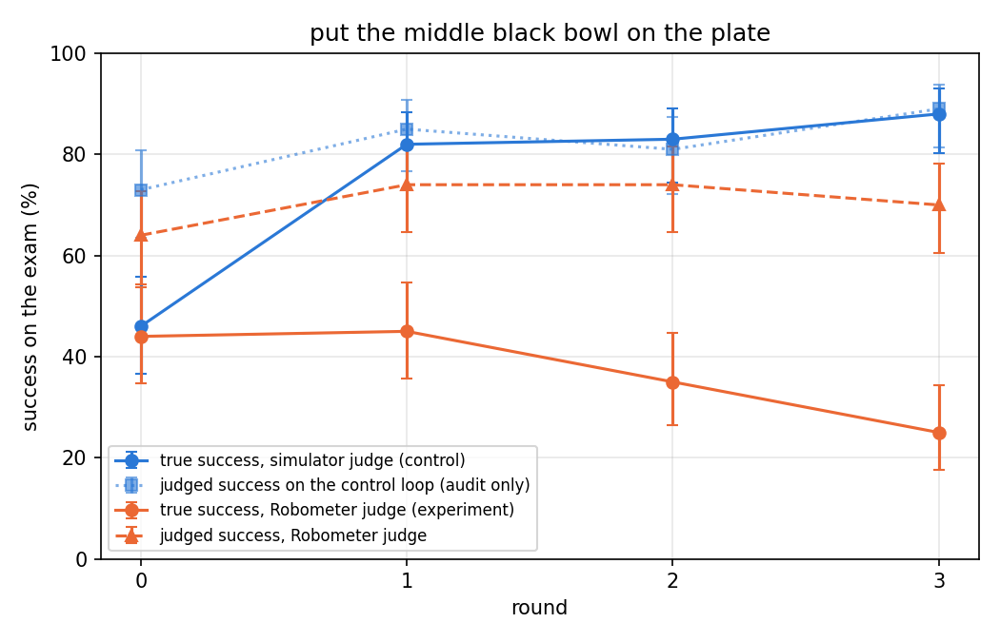

# Rejection-sampling fine-tuning with a VLM judge

This is the method from the project proposal. The policy practices one task, a judge decides which attempts were
successes, and the policy is fine-tuned on the attempts the judge approved. We ran that loop twice on the same task:
once with LIBERO's own success check as the judge (control) and once with Robometer-4B as the judge (experiment).
LIBERO's check scored every attempt in both loops. In the experiment it was logged and never used to pick training
data.

This track is separate from the grader-in-the-loop RL work on branch `stratos` (PPO on all ten LIBERO-10 tasks,
written up in that branch's root README). The two tracks share the grader and the question. They differ in method,
task and starting policy. This file covers the RFT track only: what was run, what came out, and how to rerun it.

**Status (2026-11-12):** both loops have finished on one H200, one seed each.

- **With the simulator as judge, the loop works.** True success on the held-out task went from 42% to 83% in three
  rounds.
- **With Robometer as judge, the policy got worse:** 44% to 33%. Robometer's own reading of the same policies stayed
  between 64% and 74%.
- **42 to 50% of the attempts Robometer approved were failures.** Counted in frames, which is what the trainer
  samples, failures were 73 to 77% of each training set.
- **The task is decided by which of three identical bowls the robot grabs first.** The control loop taught that
  choice. The Robometer loop did not. Its policy drifted toward a clean delivery of the wrong bowl, and Robometer
  passes more of those failures than it did at the start.
- These are single runs. Two more seeds are the next step ([Next](#next)).



*Exam success per round, 100 attempts on the same layouts for every policy. Solid lines are LIBERO's check, dashed and
dotted lines are Robometer's verdict on the same attempts. Bars are 95% intervals. The exam overstated the experiment's
final drop; see [True success](#true-success).*

## Setup

- **Task:** LIBERO-90 `KITCHEN_SCENE2`, "put the middle black bowl on the plate" (task 14). The scene has three
  identical black bowls and a plate. It was picked from the [50-trial sweep](../results/libero90_sweep_50/) because
  the starting policy succeeds about 44% of the time, so there are successes to learn from and room to improve.
- **Starting policy:** `pi05_libero`, trained by openpi on the four 10-task suites and never on LIBERO-90. The loop
  uses no demonstrations. The policy trains only on its own attempts.
- **Judges:**
  - `sim`: LIBERO's success check.
  - `robometer`: [Robometer-4B](https://huggingface.co/robometer/Robometer-4B), whose training data also holds out
    LIBERO-90. An attempt is approved when the success probability on the last of 8 sampled frames is at least
    0.65, the value in the authors' LIBERO wrapper. Videos are in Robometer's training orientation
    ([Frame orientation](#frame-orientation-for-the-grader)).
- **One round:**
  1. The current policy makes 300 practice attempts, each from a new seeded random layout.
  2. The judge labels them. Approved attempts become the training set.
  3. Full fine-tune of the current policy on that set: 1,000 steps, batch 32, peak learning rate 5e-5, no EMA.
  4. The new policy takes a 100-attempt exam on fixed layouts, the same 100 for every policy in both loops.
- **Rounds:** three per loop. A round of the experiment took about 2.5 hours on one H200: 95 minutes of attempts, 5
  of grading, 25 of training, 20 of exam. Rounds get shorter as the policy improves, because successes end early.
  The control loop took 6.6 hours and the experiment 8.2.
- **Gate before the experiment:** Robometer was audited on the control loop's first 300 attempts. Its precision at
  0.65 was 0.54 against a floor of 0.5 set in advance
  ([audit](../results/rft_middle_bowl/audit_control_round1.md)).
- Every number above is in [configs/rft/middle_bowl.json](../configs/rft/middle_bowl.json).

## Results

### True success

Each policy has two samples on layouts it never trained on: its exam, and the 300 practice attempts it made for the
next round. The final policies had no next round, so we ran 300 extra attempts for each after the loops finished.

| Judge | Policy | Exam | Practice | Both | 95% interval |
|---|---|---|---|---|---|
| Simulator | start | 46/100 | 123/300 | 42.2% | 38 to 47 |
| Simulator | after round 1 | 82/100 | 224/300 | 76.5% | 72 to 80 |
| Simulator | after round 2 | 83/100 | 242/300 | 81.2% | 77 to 85 |
| Simulator | after round 3 | 88/100 | 243/300 | **82.8%** | 79 to 86 |
| Robometer | start | 44/100 | 133/300 | 44.2% | 39 to 49 |
| Robometer | after round 1 | 45/100 | 127/300 | 43.0% | 38 to 48 |
| Robometer | after round 2 | 35/100 | 120/300 | 38.8% | 34 to 44 |
| Robometer | after round 3 | 25/100 | 107/300 | **33.0%** | 29 to 38 |

- **The control loop doubled true success** and levelled off after round 2.
- **The Robometer loop lost about 11 points.** Start against final on 400 attempts each: z = -3.3, p = 0.001.
- **The exam alone exaggerated the loss.** It read 25% for the final policy where the 300 practice attempts read 36%.
  One hundred fixed layouts are a noisy ruler: the exam also read 2 to 7 points high for every control policy.
- **Robometer did not see the loss.** Its verdict on the experiment's exams was 64%, 74%, 74%, 70%.

### What Robometer approved

The training sets of the experiment loop:

| Round | Approved of 300 | True successes | Failures | Failures by episode | Failures by frame |
|---|---|---|---|---|---|
| 1 | 215 | 123 | 92 | 43% | 73% |
| 2 | 209 | 121 | 88 | 42% | 74% |
| 3 | 231 | 116 | 115 | 50% | 77% |

- Robometer approved 92 to 97% of the true successes and 51 to 64% of the failures.
- **Failures are long.** Every failure in both loops (1,433 of 1,433) ran to the 400-step limit. Successes stop when
  LIBERO's check fires, after 115 steps on average. openpi samples training frames uniformly, so a kept failure
  weighs about 3.5 times a kept success.
- The control loop's training sets were 123, 224 and 242 attempts, all true successes.

### The task is decided by the first grab

We logged the gripper's position and its open or close command at every step. A grab is a stretch of closed-gripper
command, and its place is where the gripper was when it closed, assigned to the nearest of four spots (three bowls
and the plate). Check on the method: 1,009 of 1,013 successes with exactly one grab start at the middle bowl. Code:
[analysis/first_grasp.py](../analysis/first_grasp.py).

| Judge | Policy | Middle bowl first | Success if so | Success if not |
|---|---|---|---|---|
| Simulator | start | 131/300 (44%) | 121/131 | 2/169 |
| Simulator | after round 1 | 240/300 (80%) | 214/240 | 10/60 |
| Simulator | after round 2 | 258/300 (86%) | 238/258 | 4/42 |
| Simulator | after round 3 | 266/300 (89%) | 232/266 | 11/34 |
| Robometer | start | 138/300 (46%) | 131/138 | 2/162 |
| Robometer | after round 1 | 138/300 (46%) | 124/138 | 3/162 |
| Robometer | after round 2 | 132/300 (44%) | 120/132 | 0/168 |
| Robometer | after round 3 | 113/300 (38%) | 107/113 | 0/187 |

- **A correct first grab succeeds about 9 times in 10. A wrong one almost never recovers.** The wrong grab is nearly
  always the bowl at the back.
- **The control loop's whole gain is the choice.** Its training sets opened with the wrong bowl in 2 to 4% of
  attempts, and the policy's wrong-first rate fell from 56% to 11%. Skill after a correct grab did not change.
- **The Robometer loop's training sets opened with the wrong bowl in 39 to 46% of attempts.** The policy's own rate
  was 54 to 56%, so those sets carried little signal about the choice.
- On the final 300 layouts, shared by both final policies: both grab the middle bowl first on 113, only the control's
  on 153, neither on 34, only the experiment's on 0.

### What the Robometer-judged policy drifted toward

"One wrong delivery" is a failure where the robot carries exactly one bowl to the plate, it is not the middle bowl,
and it grabs no third bowl. Counts are out of 300 practice attempts per policy.

| Judge | Policy | Wrong bowl first | One wrong delivery | Failures Robometer approved | Robometer says | True |
|---|---|---|---|---|---|---|
| Robometer | start | 54% | 63 | 92/167 (55%) | 72% | 44% |
| Robometer | after round 1 | 54% | 54 | 88/173 (51%) | 70% | 42% |
| Robometer | after round 2 | 56% | 76 | 115/180 (64%) | 77% | 40% |
| Robometer | after round 3 | 62% | 121 | 131/193 (68%) | 76% | 36% |
| Simulator | start | 56% | 55 | 96/177 (54%) | 69% | 41% |
| Simulator | after round 1 | 20% | 20 | 41/76 (54%) | 82% | 75% |
| Simulator | after round 2 | 14% | 12 | 33/58 (57%) | 83% | 81% |
| Simulator | after round 3 | 11% | 8 | 28/57 (49%) | 83% | 81% |

- **All of the Robometer loop's loss is the choice.** Wrong-first went from 54% to 62% (trend p = 0.03). Success
  after a correct grab stayed at 90 to 95%.
- **Its failures became tidy.** The final policy carries one wrong bowl to the plate and touches nothing else in 121
  of 300 attempts, against 63 at the start. That is the sibling LIBERO-90 task "put the black bowl at the back on
  the plate", done cleanly.
- **Robometer approves more of its failures:** 55% at the start, 68% at the end (trend p = 0.002). The control's
  failures stayed near 54%.
- **The gap between judged and true success grew** from 27 points to 41 in the experiment and shrank from 28 to 2 in
  the control. The gap closes when the policy is good and opens when it is not, because Robometer says yes to about
  half of all failures.

### A second grader, offline

`jesbu1/robometer-4b-fft-libero` is Robometer-4B fine-tuned on all five LIBERO suites, LIBERO-90 included. We scored
the experiment's 1,300 loop episodes with it and trained nothing on its verdicts. Cells are precision / recall / false-positive rate.

| Grader | AUROC | at 0.65 | at 0.85 | at 0.99 | at 0.995 |
|---|---|---|---|---|---|
| Robometer-4B | 0.77 | 0.53 / 0.94 / 0.57 | 0.68 / 0.36 / 0.12 | approves none | approves none |
| LIBERO fine-tune | 0.90 | 0.57 / 0.96 / 0.49 | 0.62 / 0.91 / 0.39 | 0.87 / 0.72 / 0.07 | 0.93 / 0.64 / 0.03 |

- **It ranks attempts much better and would have built the same training sets at 0.65:** 70 to 74% failure frames.
- **Its scores pile up near 1.** Only at 0.995 would the sets be mostly clean: 83 to 93 attempts per round with 22
  to 26% failure frames. That threshold was read off these data, so it is a hypothesis, not a result.

### Agreement with the RL track

The RL runs on `stratos` found Robometer about 2x too optimistic on LIBERO-10: it passed 46 to 52% of failures, with
AUROC 0.73 to 0.77. Here, on a different task, method and policy, it passed 55 to 59% of failures at 0.65 with AUROC
0.77 over 3,200 episodes. Our videos are already in Robometer's training orientation, so orientation alone does not
remove the optimism.

### Limits

- **One seed per loop.** Run-to-run noise is visible: the first practice set of each loop is the same starting policy
  on the same 300 layouts, and the two runs agree on the first bowl in 256 of them and score 41% and 44%.
- **The 300 extra attempts for the final policies were added after seeing the exam.** They use the config's seed
  rule for a fourth round and no setting was changed.
- **Why the policy moved toward the wrong bowl is not settled.** Counted by episode, the approved sets were less
  wrong-first (39 to 46%) than the policy itself (54 to 56%). Counted by frame, they were mostly failures.
- **Why Robometer approves more of the later failures is not explained** by the gripper paths. The rate rose for
  every kind of failure we can tell apart. It needs a look at the videos.
- The first-grab assignment is geometric and specific to this scene.

## Result files

Small files are in [results/rft_middle_bowl/](../results/rft_middle_bowl/). Rollout videos, datasets and checkpoints
stay under `runs/` on the training box and are not in git.

| File | Holds |
|---|---|
| `episodes.csv` | One row per logged episode, 3,200 in all: loop, exam or practice, the checkpoint that made it (0 is the start), seed, LIBERO's label, steps, Robometer's score and verdict, first grab, grab count, the one-wrong-delivery flag, and the LIBERO fine-tune's score where it was run. Every table above can be recomputed from it. |
| `metrics/<judge>_round_<k>.json` | The loop's own summary for the policy after k rounds: exam success with interval, judged success, training-set size. `_round_3_practice.json` is the extra 300 attempts. |
| `logs/` | The two loop logs and the log of the extra practice sets. |
| `audit_control_round1.md` | The audit that gated the experiment. |
| `curves.png` | The figure above. |

## Running it

### Pieces

| File | Runs in | Does |
|---|---|---|
| `scripts/rollout_worker.py` | LIBERO client env (Python 3.8) | N attempts of one task against the policy server, each from a seeded random layout; writes frames, videos, and `episodes_extra.jsonl` |
| `scripts/rollout_and_log.py` | openpi env | Launches the worker, writes `metrics.json` (true success with 95% interval), optionally packs a LeRobot dataset |
| `rft/lerobot_pack.py` | openpi env | Raw episodes to a LeRobot v2.1 dataset in openpi's LIBERO schema plus a `sim_success` column and the sidecar |
| `scripts/finetune_round.py` | openpi env | Full fine-tune of a checkpoint on a dataset with the round config; runs openpi's own trainer |
| `grader/programs/robometer_grade.py` | Robometer env | The grader program (from branch `stratos`); last-frame success probability per video |
| `grader/robometer.py` | any | Grades a rollout directory through the program above and writes `grader_*` fields into the sidecar |
| `scripts/make_grader_videos.py` | LIBERO client env | Grader-oriented videos from `frames.npz` for rollouts logged before the worker wrote them (`--raw` adds the raw render) |
| `grader/audit.py` | any | Confusion matrix against the simulator at several thresholds, the D5 verdict, false positives to watch |
| `rft/select.py` | any | The only place a verdict becomes training data; one field per judge |
| `scripts/loop.py` | any (orchestration only) | Rounds: rollouts, grade, select, pack, fine-tune, exam, `metrics.json`; resumable |
| `analysis/plot_curves.py` | openpi env | True success per round for both loops plus judged success |
| `analysis/first_grasp.py` | `dump`: LIBERO client env; `count`: any | Gripper paths out of `frames.npz`, then first grab per attempt, the tables above, and `episodes.csv` |

### Setup on sci-ai (once)

```
source /sci-ai-pool/data/shared/slee3321/env.sh      # WORK, caches, CUDA_VISIBLE_DEVICES
cd $WORK/self-improving-policies
scripts/setup_openpi.sh                               # done already
uv run scripts/download_checkpoints.py                # done already
scripts/setup_robometer.sh                            # grader env + Robometer-4B; add --in-domain for the second grader
```

Port 8000 is taken on sci-ai; the configs use 8001. Nothing else may be using the card while a round trains.

### Smoke test (minutes, before any real round)

```
third_party/openpi/.venv/bin/python scripts/loop.py --config configs/rft/middle_bowl.json --judge sim --dry-run
cp configs/rft/middle_bowl.json configs/rft/smoke.json   # then edit: run_name smoke, rollouts_per_round 12, min_kept 2, exam_episodes 10, train.steps 20, train.warmup_steps 2, train.save_interval 20
python3 scripts/loop.py --config configs/rft/smoke.json --judge sim --rounds 1
```

A passing smoke test shows: a round_0 exam metrics.json, 12 logged rollouts with videos and `frames.npz`, `kept.json`,
a packed `lerobot/rft/train` dataset, a checkpoint directory with `params/` and `assets/`, and a round_1 exam.
Then grade and audit the smoke rollouts to check the grader end to end:

```
python3 -c "from grader.robometer import grade_rollouts; from rft.config import LoopConfig; import pathlib; grade_rollouts(pathlib.Path('runs/smoke/sim/round_1/rollouts'), LoopConfig.load('configs/rft/smoke.json').grader)"
python3 grader/audit.py runs/smoke/sim/round_1/rollouts --config configs/rft/smoke.json
```

### The real runs

```
tmux new -s rft
python3 scripts/loop.py --config configs/rft/middle_bowl.json --judge sim --audit-with robometer   # control, graded for the audit
python3 grader/audit.py runs/middle_bowl/sim/round_1/rollouts --config configs/rft/middle_bowl.json   # D5 gate
python3 scripts/loop.py --config configs/rft/middle_bowl.json --judge robometer                     # experiment
third_party/openpi/.venv/bin/python analysis/plot_curves.py runs/middle_bowl
```

The control loop must show rising true success before the experiment loop runs (non-negotiable 4), and the audit's
precision at 0.65 must be at least 0.5 (D5). Re-running a loop command resumes at the first unfinished stage.

### Extra practice attempts for the final policies

The loop has no flag for this yet. This calls its own functions to make and grade 300 attempts from each loop's last
checkpoint, on the seeds a fourth round would use. It took 2.7 hours for both.

```
third_party/openpi/.venv/bin/python - <<'EOF' 2>&1 | tee runs/middle_bowl_round4_rollouts.log
import sys, types, pathlib
sys.path.insert(0, "scripts")
import loop
cfg = loop.LoopConfig.load(pathlib.Path("configs/rft/middle_bowl.json"))
args = types.SimpleNamespace(config=pathlib.Path("configs/rft/middle_bowl.json"), no_video=False)
for judge in ("robometer", "sim"):
    run_dir = loop.REPO / "runs" / cfg.run_name / judge
    ckpt = loop.previous_checkpoint(cfg, run_dir, 4)
    out = run_dir / "round_4" / "rollouts"
    loop.run_rollouts(cfg, args, out, "rollout", 4, ckpt, None)
    loop.grade(cfg, out)
EOF
```

### First-grab counts

```
third_party/openpi/examples/libero/.venv/bin/python analysis/first_grasp.py dump runs/middle_bowl    # on the box
python3 analysis/first_grasp.py count runs/middle_bowl --config configs/rft/middle_bowl.json --csv results/rft_middle_bowl/episodes.csv
```

`dump` writes one small `grasp_trace.json` per rollout folder. `count` needs only those files and the sidecars, so it
runs on a laptop after copying them. The traces behind these results were written by the same few lines run inline;
the `dump` command itself has not been run on the box yet.

### Round layout

`runs/<run_name>/<judge>/round_k/` holds the attempts made by the round k-1 checkpoint (`rollouts/`), the judge's
selection (`kept.json`), the kept episodes as a dataset (`lerobot/rft/train`, plus `rft/all` for every attempt),
the round k checkpoint (`checkpoint/pi05_rft/round_k/<step>`), the round k exam (`exam/`), and `metrics.json`.
`round_0/` holds only the base checkpoint's exam. So `metrics.json` in `round_k` describes the brain after k
fine-tunes, and the plot's x axis is k. `round_4/rollouts/` holds the extra practice attempts of the final policies.

### Frame orientation for the grader

Robometer's LIBERO training frames are the raw agentview render flipped vertically (its dataset loader). The policy,
openpi, and our videos use the raw render rotated 180 degrees, the left-right mirror of that. So the worker writes
two third-person videos per episode: `agentview.mp4` (upright, for humans) and `agentview_grader.mp4` (mirrored, what
the grader scores; `grader.camera` in the config). To compare orientations on logged rollouts without touching the
sidecar:

```
third_party/openpi/examples/libero/.venv/bin/python scripts/make_grader_videos.py <rollout_dir> --raw
for cam in agentview agentview_grader agentview_raw; do python3 -m grader.robometer <rollout_dir> --config <cfg> --camera $cam --no-sidecar; done
```

### Numbers that must not be hardcoded

Rounds, rollouts per round, minimum kept, exam size, seeds, the grader threshold, and the round's training settings
all live in the config. `tests/` checks that seeds never collide and that selection reads only the judge's field:

```
python3 -m unittest discover -s tests
```

## Next

1. **Seeds 2 and 3 of both loops,** config numbers unchanged, with the 300 extra attempts for the final policies
   planned from the start. Every policy then has 400 fresh attempts and the claims can carry intervals over seeds.
2. **The LIBERO fine-tune as judge at 0.65,** one seed. From the offline scores we expect the same flat or falling
   curve.
3. **Videos of the final policy's approved failures,** to see what Robometer is responding to.
